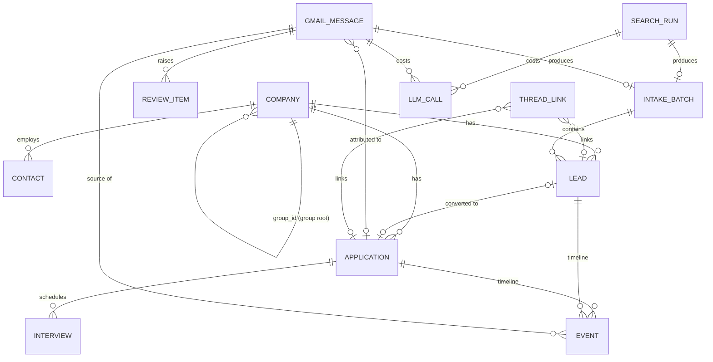

# Offerbound — Data Model

| | |
|---|---|
| Status | **Approved** (2026-10-29) |
| Version | 1.0 (2026-10-29) |
| Store | PostgreSQL 17, managed with Prisma 6 migrations; pg-boss owns schema `pgboss` |

Single-tenant by design (D4): there is no `user_id` or tenant column anywhere. One database = one owner. The demo is a separate database.

Conventions: `uuid` primary keys (`gen_random_uuid()`) unless noted; `timestamptz` for every time; `created_at`/`updated_at` on mutable tables; `version int not null default 1` on records the owner can edit (optimistic concurrency and undo, TECHNICAL_SPEC §6.6). Text arrays hold normalised values. Money is `numeric(12,2)`; currencies are ISO 4217 codes.

---

## 1. Entity relationships



Standalone tables: `session`, `gmail_connection` (singleton), `candidate_profile`, `setting`, `daily_activity`, `import_preview`.

## 2. Enums

| Enum | Values |
|---|---|
| `application_status` | `applied`, `screening`, `assessment`, `interviewing`, `offer`, `accepted`, `rejected`, `withdrawn`, `abandoned` |
| `application_source` | `sheet_import`, `gmail`, `lead_conversion`, `manual` |
| `lead_status` | `new`, `shortlisted`, `dismissed`, `applied`, `suppressed` |
| `lead_pipeline_state` | `checking`, `ranking`, `ready` |
| `suppressed_reason` | `company_already_seen`, `same_company_in_batch`, `excluded_seniority`, `ineligible` |
| `lead_source` | `search_agent`, `gmail_alert`, `gmail_recruiter`, `sheet_import`, `paste_report`, `manual` |
| `verification` | `pending`, `verified`, `unverified`, `unverifiable` (dead links are deleted, not stored) |
| `work_mode` | `remote`, `hybrid`, `onsite`, `unknown` |
| `tri_state` | `yes`, `no`, `unknown` |
| `seniority` | `junior`, `mid`, `senior`, `staff_plus`, `lead`, `manager`, `unknown` |
| `comp_period` | `year`, `month`, `hour` |
| `interview_kind` | `recruiter_screen`, `hiring_manager`, `technical`, `system_design`, `behavioral`, `take_home_review`, `onsite_loop`, `other` |
| `interview_status` | `to_schedule`, `scheduled`, `completed`, `cancelled` |
| `message_state` | `discovered`, `skipped`, `triaged_out`, `job_related`, `extracted`, `applied`, `needs_review`, `failed` |
| `message_direction` | `inbound`, `outbound` |
| `triage_method` | `rule`, `llm` |
| `email_category` | `application_confirmation`, `rejection`, `interview_invite`, `interview_reschedule`, `interview_cancellation`, `assessment`, `offer`, `recruiter_outreach`, `job_alert`, `status_update_other`, `candidate_outbound`, `not_job_related` |
| `event_type` | `imported`, `email_received`, `email_sent`, `application_created`, `lead_created`, `lead_converted`, `status_changed`, `field_updated`, `note_updated`, `interview_created`, `interview_updated`, `interview_cancelled`, `interview_completed`, `follow_up_due`, `follow_up_done`, `abandoned`, `reopened`, `merged`, `undone` |
| `actor` | `system`, `owner`, `import` |
| `review_kind` | `low_confidence`, `ambiguous_match`, `unexpected_transition`, `possible_duplicate_company`, `extraction_failed`, `undone_change` |
| `review_state` | `open`, `resolved`, `dismissed` |
| `connection_status` | `active`, `needs_reauth`, `missing_scope`, `disconnected` (no row = not connected) |
| `backfill_state` | `not_started`, `running`, `done`, `failed` |
| `search_trigger` | `schedule`, `manual` |
| `search_run_status` | `running`, `succeeded`, `partial`, `failed` |
| `intake_batch_kind` | `search_run`, `gmail_message`, `paste_report`, `sheet_import`, `manual` |
| `llm_purpose` | `triage`, `extract`, `rank`, `search`, `parse_report`, `cv_profile` |
| `llm_call_status` | `ok`, `error` |

## 3. Tables

### 3.1 `company`

| Column | Type | Null | Notes |
|---|---|---|---|
| `id` | uuid | no | PK |
| `version` | int | no | default 1 |
| `name` | text | no | display name |
| `normalized_name` | text | no | **unique**; `normalizeCompanyName(name)` |
| `aliases` | text[] | no | default `{}`; normalised alternative names |
| `domains` | text[] | no | default `{}`; registrable domains (never generic or ATS domains) |
| `ats_slugs` | text[] | no | default `{}`; e.g. `ashby:halter`, `lever:acme` |
| `website_domain` | text | yes | |
| `group_id` | uuid | yes | FK `company.id` (the group root), `on delete set null`; a root has `null` |
| `created_source` | text | no | `gmail`, `search_agent`, `sheet_import`, `paste_report`, `manual` |
| `created_at`, `updated_at` | timestamptz | no | |

Indexes: GIN on `aliases`, `domains`, `ats_slugs`; btree `group_id`.

"Company already seen" for company *C* = exists a `lead` or `application` whose `company_id` is in `{C} ∪ {companies with the same group root}` and `created_at` < the batch's `created_at`.

### 3.2 `contact`

| Column | Type | Null | Notes |
|---|---|---|---|
| `id` | uuid | no | PK |
| `company_id` | uuid | yes | FK `company`, `on delete set null` (null for agencies not tied to one company) |
| `email` | citext | no | **unique** |
| `name`, `title` | text | yes | |
| `is_agency` | boolean | no | default false |
| `created_at`, `updated_at` | timestamptz | no | |

### 3.3 `lead`

| Column | Type | Null | Notes |
|---|---|---|---|
| `id` | uuid | no | PK |
| `version` | int | no | default 1 |
| `company_id` | uuid | no | FK `company` |
| `intake_batch_id` | uuid | no | FK `intake_batch` |
| `title` | text | no | |
| `job_url` | text | yes | original link |
| `job_key` | text | yes | **unique where not null** (TECHNICAL_SPEC §6.1) |
| `location_text`, `country` | text | yes | |
| `work_mode` | work_mode | no | default `unknown` |
| `remote_from_home_country`, `sponsorship`, `relocation` | tri_state | no | default `unknown` |
| `sponsorship_text` | text | yes | free text (e.g. from the spreadsheet) |
| `compensation_text` | text | yes | as written in the source |
| `comp_min`, `comp_max` | numeric(12,2) | yes | |
| `comp_currency` | char(3) | yes | |
| `comp_period` | comp_period | yes | |
| `comp_is_estimate` | boolean | no | default false |
| `comp_basis` | text | yes | where an estimate comes from |
| `seniority` | seniority | no | default `unknown` |
| `track` | text | yes | a key from settings `search.tracks` |
| `fit_score` | smallint | yes | 0–100 |
| `fit_reason` | text | yes | ≤ 160 chars |
| `gaps` | text[] | no | default `{}` |
| `eligible` | tri_state | no | default `unknown` |
| `eligibility_reason` | text | yes | |
| `status` | lead_status | no | default `new` |
| `status_changed_at` | timestamptz | no | |
| `pipeline_state` | lead_pipeline_state | no | default `checking` |
| `suppressed_reason` | suppressed_reason | yes | set iff `status = suppressed` |
| `dismissed_reason` | text | yes | e.g. `not_interested`, `posting_closed`, `not_pursued_imported`, free text |
| `company_seen_before` | boolean | no | default false (recruiter outreach exception) |
| `verification` | verification | no | default `pending` |
| `verified_at` | timestamptz | yes | |
| `page_excerpt` | text | yes | ≤ 8,000 chars from the link check |
| `ranked_at` | timestamptz | yes | |
| `source` | lead_source | no | |
| `source_message_id` | text | yes | FK `gmail_message.id`, `on delete set null` |
| `contact_id` | uuid | yes | FK `contact` |
| `posted_at` | timestamptz | yes | |
| `found_at` | timestamptz | no | default now() |
| `application_id` | uuid | yes | **unique**; FK `application`, `on delete set null` |
| `notes` | text | yes | |
| `created_at`, `updated_at` | timestamptz | no | |

Indexes: `(status, pipeline_state, track, fit_score desc)`, `company_id`, `intake_batch_id`, `found_at`.
Check: `(status = 'suppressed') = (suppressed_reason is not null)`. Application code keeps `status = 'applied'` and `application_id` in step; when the linked application is deleted (undo, merge) the lead returns to `shortlisted` (TECHNICAL_SPEC §6.6).

### 3.4 `application`

| Column | Type | Null | Notes |
|---|---|---|---|
| `id` | uuid | no | PK |
| `version` | int | no | default 1 |
| `company_id` | uuid | no | FK `company` |
| `lead_id` | uuid | yes | **unique**; FK `lead`, `on delete set null` |
| `title` | text | no | |
| `job_url` | text | yes | |
| `job_key` | text | yes | **unique where not null** |
| `location_text`, `country` | text | yes | |
| `work_mode` | work_mode | no | default `unknown` |
| `compensation_text`, `sponsorship_text` | text | yes | free text (imported or extracted) |
| `status` | application_status | no | |
| `status_changed_at` | timestamptz | no | |
| `status_before_abandon` | application_status | yes | set when timers abandon |
| `applied_at` | timestamptz | yes | |
| `last_company_activity_at` | timestamptz | yes | the company clock (F7) |
| `last_outbound_at` | timestamptz | yes | |
| `follow_up_due` | boolean | no | default false |
| `follow_up_due_since` | timestamptz | yes | |
| `follow_up_done_at` | timestamptz | yes | |
| `source` | application_source | no | |
| `notes` | text | yes | imported spreadsheet notes land here |
| `created_at`, `updated_at` | timestamptz | no | |

Indexes: `status`, `company_id`, partial `follow_up_due where follow_up_due`, `(last_company_activity_at)`.

### 3.5 `interview`

| Column | Type | Null | Notes |
|---|---|---|---|
| `id` | uuid | no | PK |
| `version` | int | no | default 1 |
| `application_id` | uuid | no | FK `application`, `on delete cascade` |
| `kind` | interview_kind | no | |
| `status` | interview_status | no | |
| `starts_at`, `ends_at` | timestamptz | yes | null when `to_schedule` |
| `timezone_hint` | text | yes | IANA zone stated in the invite |
| `meeting_url`, `scheduling_url`, `location` | text | yes | |
| `interviewers` | text[] | no | default `{}` |
| `ics_uid` | text | yes | **unique where not null** — calendar updates hit the same row |
| `source_message_id` | text | yes | FK `gmail_message.id`, `on delete set null` |
| `notes` | text | yes | prep notes |
| `created_at`, `updated_at` | timestamptz | no | |

Indexes: `(status, starts_at)`, `application_id`.

### 3.6 `gmail_message`

One row per Gmail message Offerbound has seen. **Content columns are null unless the message is job-related** (D26, SECURITY §3).

| Column | Type | Null | Notes |
|---|---|---|---|
| `id` | text | no | PK — Gmail message id |
| `thread_id` | text | no | |
| `internal_date` | timestamptz | no | Gmail `internalDate` |
| `direction` | message_direction | no | `outbound` when labelled `SENT` |
| `label_ids` | text[] | no | |
| `state` | message_state | no | default `discovered` |
| `triage_method` | triage_method | yes | |
| `triage_rule` | text | yes | `R1`…`R9` |
| `triage_confidence` | real | yes | |
| `category` | email_category | yes | |
| `extract_confidence` | real | yes | |
| `extraction` | jsonb | yes | validated `Extraction` output |
| `ics_events` | jsonb | yes | parsed calendar events |
| `from_email`, `from_name` | text | yes | job-related only |
| `to_emails` | text[] | yes | job-related only |
| `subject`, `snippet` | text | yes | job-related only |
| `body_text` | text | yes | job-related only; ≤ 15,000 chars |
| `summary` | text | yes | one line for the timeline |
| `application_id` | uuid | yes | FK `application`, `on delete set null` |
| `attempts` | int | no | default 0; failed triage attempts while `discovered`, then resends to extraction while `job_related` (reset when triage decides the message; the fifth resend fails it) |
| `last_error` | text | yes | error code only, never content |
| `discovered_at` | timestamptz | no | default now() |
| `processed_at` | timestamptz | yes | when the message last left a stage; while `job_related` it is a heartbeat (each extraction attempt stamps it) or, after a Gmail `Retry-After`, the deferred job's due time; the resend sweep sends the message again only when this is 10 minutes old |
| `updated_at` | timestamptz | no | |

Indexes: `(state, internal_date)`, `thread_id`, `application_id`.
Rule: transitions to `triaged_out` or `skipped` (including after extraction says `not_job_related`) set every content column to null in the same statement.

### 3.7 `thread_link`

| Column | Type | Null | Notes |
|---|---|---|---|
| `thread_id` | text | no | PK |
| `application_id` | uuid | yes | FK `application`, `on delete cascade` |
| `lead_id` | uuid | yes | FK `lead`, `on delete cascade` |
| `created_at` | timestamptz | no | |

Check: at least one of `application_id`, `lead_id` is set. Converting a lead fills `application_id` on its links.

### 3.8 `event` (timeline and audit)

| Column | Type | Null | Notes |
|---|---|---|---|
| `id` | uuid | no | PK |
| `application_id` | uuid | yes | FK, `on delete cascade` |
| `lead_id` | uuid | yes | FK, `on delete cascade` |
| `company_id` | uuid | yes | FK, `on delete set null` |
| `type` | event_type | no | |
| `actor` | actor | no | |
| `occurred_at` | timestamptz | no | email `internal_date` for email-driven events, else now |
| `message_id` | text | yes | FK `gmail_message.id`, `on delete set null` |
| `summary` | text | no | human-readable line |
| `data` | jsonb | yes | type-specific details (e.g. `{ from: "applied", to: "rejected" }`) |
| `change_set` | jsonb | yes | `[{ entity, id, created, before, after, versionAfter }]` for undo |
| `undoable` | boolean | no | false for `imported`, `undone`, owner manual edits |
| `undone_at` | timestamptz | yes | |
| `undone_by_event_id` | uuid | yes | FK `event` |
| `entity_key` | text | no | generated: `coalesce(application_id::text, lead_id::text, '-')` |
| `created_at` | timestamptz | no | |

Indexes: `(application_id, occurred_at desc)`, `(lead_id, occurred_at desc)`; **unique** `(message_id, type, entity_key) where message_id is not null` (idempotency, TECHNICAL_SPEC §14).

### 3.9 `review_item`

| Column | Type | Null | Notes |
|---|---|---|---|
| `id` | uuid | no | PK |
| `kind` | review_kind | no | |
| `state` | review_state | no | default `open` |
| `message_id` | text | yes | FK `gmail_message.id`, `on delete cascade` |
| `application_id`, `lead_id`, `company_id` | uuid | yes | context; FKs `on delete cascade` |
| `confidence` | real | yes | |
| `plan` | jsonb | yes | the proposed `ChangePlan` |
| `candidates` | jsonb | no | default `[]`; `[{ id, label }]` |
| `reasons` | text[] | no | default `{}` |
| `resolution` | jsonb | yes | `{ action, by: "owner", at, applicationId?, edits? }` |
| `created_at` | timestamptz | no | |
| `resolved_at` | timestamptz | yes | |

Indexes: `(state, created_at desc)`; **unique** `(message_id, kind) where state = 'open' and message_id is not null`.

### 3.10 `intake_batch`

| Column | Type | Null | Notes |
|---|---|---|---|
| `id` | uuid | no | PK |
| `kind` | intake_batch_kind | no | |
| `search_run_id` | uuid | yes | FK `search_run` |
| `message_id` | text | yes | FK `gmail_message.id`, `on delete set null` |
| `file_hash` | text | yes | **unique where not null** — SHA-256 of an imported file (AC-14.5) |
| `counts` | jsonb | no | `{ received, duplicates, suppressed, dead, accepted }` |
| `created_at` | timestamptz | no | |
| `finalized_at` | timestamptz | yes | set by `leads.finalize` |

### 3.11 `import_preview`

| Column | Type | Null | Notes |
|---|---|---|---|
| `id` | uuid | no | PK |
| `kind` | text | no | `sheet_csv` or `paste_report` |
| `file_hash` | text | yes | |
| `payload` | jsonb | no | parsed rows with annotations |
| `created_at` | timestamptz | no | |
| `expires_at` | timestamptz | no | created + 1 hour |

### 3.12 `search_run`

| Column | Type | Null | Notes |
|---|---|---|---|
| `id` | uuid | no | PK |
| `trigger` | search_trigger | no | |
| `status` | search_run_status | no | |
| `started_at` | timestamptz | no | |
| `finished_at` | timestamptz | yes | |
| `rounds` | smallint | no | default 0 |
| `returned`, `accepted`, `suppressed`, `duplicates`, `dead` | int | no | default 0 |
| `web_search_calls` | int | no | default 0 |
| `cost_micros` | bigint | yes | |
| `brief_hash` | text | no | SHA-256 of the brief used (not the brief) |
| `error` | text | yes | error code + short message, no content |

Index: `started_at desc`. Partial unique index on `status where status = 'running'` (at most one running run).

### 3.13 `candidate_profile`

| Column | Type | Null | Notes |
|---|---|---|---|
| `id` | uuid | no | PK |
| `file_name` | text | no | |
| `mime_type` | text | no | |
| `size_bytes` | int | no | |
| `text_content` | text | no | extracted CV text (the file itself is not stored) |
| `profile` | jsonb | yes | `CvProfile` |
| `profile_status` | text | no | `ok` or `failed` |
| `model` | text | yes | |
| `is_active` | boolean | no | **unique where true** |
| `uploaded_at` | timestamptz | no | |

### 3.14 `gmail_connection` (singleton)

| Column | Type | Null | Notes |
|---|---|---|---|
| `id` | smallint | no | PK, check `id = 1` |
| `google_sub` | text | no | Google account id |
| `email` | text | no | |
| `scopes` | text[] | no | granted scopes |
| `refresh_token_enc` | text | yes | `v1:<iv>:<ciphertext>:<tag>` (AES-256-GCM, base64) |
| `access_token_enc` | text | yes | same format |
| `access_token_expires_at` | timestamptz | yes | |
| `status` | connection_status | no | |
| `history_id` | text | yes | incremental sync cursor |
| `started_at` | timestamptz | yes | when the owner pressed *Start syncing* |
| `last_sync_at` | timestamptz | yes | |
| `last_sync_error` | text | yes | error code + short message |
| `backfill_since` | date | no | from `GMAIL_BACKFILL_SINCE` at start |
| `backfill_state` | backfill_state | no | default `not_started` |
| `backfill_page_token` | text | yes | |
| `backfill_listed` | int | no | default 0 |
| `created_at`, `updated_at` | timestamptz | no | |

### 3.15 `session`

| Column | Type | Null | Notes |
|---|---|---|---|
| `id_hash` | text | no | PK, SHA-256 of the cookie value |
| `created_at` | timestamptz | no | |
| `expires_at` | timestamptz | no | |
| `last_seen_at` | timestamptz | no | |
| `user_agent` | text | yes | truncated to 200 chars |

### 3.16 `setting`

| Column | Type | Null | Notes |
|---|---|---|---|
| `key` | text | no | PK: `search`, `dailyTargets`, `timers`, `automation`, `onboarding` |
| `value` | jsonb | no | validated by the zod `Settings` schema |
| `updated_at` | timestamptz | no | |

### 3.17 `daily_activity`

| Column | Type | Null | Notes |
|---|---|---|---|
| `day` | date | no | PK; the owner's local date |
| `outreach_count` | int | no | default 0 |
| `prep_minutes` | int | no | default 0 |
| `follow_ups` | int | no | default 0 (manual *Mark followed up* on today's date; detected outbound follow-ups on the owner-local date the email was sent) |
| `updated_at` | timestamptz | no | |

*Applications today* and *new leads today* are computed from `application.applied_at` and `lead.found_at` (excluding `suppressed`) in the owner's time zone.

### 3.18 `llm_call`

| Column | Type | Null | Notes |
|---|---|---|---|
| `id` | uuid | no | PK |
| `purpose` | llm_purpose | no | |
| `model` | text | no | |
| `input_tokens`, `cached_input_tokens`, `output_tokens` | int | no | |
| `web_search_calls` | int | no | default 0 |
| `cost_micros` | bigint | yes | null when pricing unknown |
| `latency_ms` | int | no | |
| `status` | llm_call_status | no | |
| `error_code` | text | yes | |
| `request_id` | text | yes | OpenAI response id |
| `message_id` | text | yes | FK `gmail_message.id`, `on delete set null` |
| `search_run_id` | uuid | yes | FK `search_run`, `on delete set null` |
| `created_at` | timestamptz | no | |

Index: `created_at`, `(purpose, created_at)`.

## 4. Settings defaults (shipped in the repo — generic, no personal data)

```json
{
  "search": {
    "brief": "Describe the roles, locations, work modes, compensation floors and exclusions you want. Edit this in Settings → Job search.",
    "tracks": [
      { "key": "A", "label": "Remote from home country", "priority": 1 },
      { "key": "B", "label": "Relocation with sponsorship", "priority": 2 }
    ],
    "excludedSeniorities": ["junior", "staff_plus", "manager"],
    "leadTarget": { "min": 20, "max": 30 },
    "runTime": "07:00",
    "enabled": false
  },
  "dailyTargets": {
    "leads": { "min": 20, "max": 30 },
    "applications": { "min": 8, "max": 12 },
    "outreach": { "min": 5 },
    "followUps": { "min": 3, "max": 5 },
    "prepMinutes": { "min": 90 }
  },
  "timers": { "followUpDays": 7, "abandonDays": 14 },
  "automation": { "autoApplyMinConfidence": 0.8, "senderIgnoreList": [] },
  "onboarding": { "completedAt": null }
}
```

`manager` in `excludedSeniorities` means non-hands-on managers; `lead` (hands-on tech lead) is allowed by default.

## 5. Spreadsheet import mapping (F14)

| Sheet column | Target |
|---|---|
| Company (first column; its header cell may contain the sheet title) | `company` via resolution (§6.2 of TECHNICAL_SPEC) |
| Role | `title` |
| Country | `country` |
| City / modality | `location_text`; `work_mode` inferred when the text contains Remote / Hybrid / On-site |
| Date applied | `application.applied_at` (00:00 owner time zone) |
| Status | `To research` → lead `new`; `Cancelled` → lead `dismissed` (`not_pursued_imported`); `Applied` → application `applied`; `Interview` → application `interviewing`; `Rejected` → application `rejected` |
| Salary | `compensation_text` |
| Sponsorship / relocation | `sponsorship_text` (lead or application); the lead's `sponsorship`/`relocation` tri-states are set by ranking |
| Job link | `job_url`, `job_key`, company `ats_slugs` |
| Notes | `notes` |

Header detection: the first row whose cells, trimmed and lower-cased, include values ending with `company`, equal to `role` and equal to `status`.

## 6. Data lifecycle

| Data | Kept | Removed by |
|---|---|---|
| Non-job email content | never stored | — |
| Job-related email content | until purge | *Delete stored email content* (Should), or record deletion |
| Leads with dead links | never stored | link check deletes them |
| Sessions | 30 days (sliding) | `maintenance.daily` |
| Import previews | 1 hour | `maintenance.daily` |
| `llm_call` | 180 days | `maintenance.daily` |
| Backups | 14 days | `backup.nightly` |
| CV file | never stored | — (text and profile only) |
| Google tokens | while connected | *Disconnect Gmail* |
