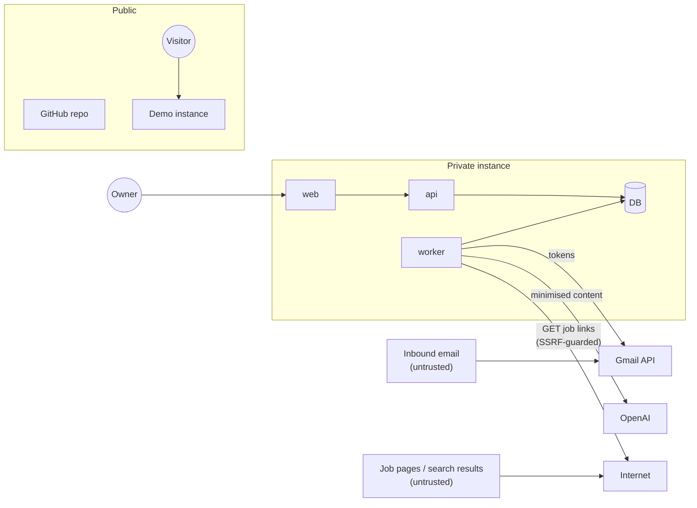

# Offerbound — Security and Privacy

| | |
|---|---|
| Status | **Approved** (2026-10-29) |
| Version | 1.0 (2026-10-29) |

Offerbound reads a personal mailbox and stores a job search. The design goal is that **a compromise of the public demo, the public repository or an LLM call cannot expose the owner's mail or search**, and that a compromise of the private instance exposes as little as possible.

---

## 1. Assets

| Asset | Where | Sensitivity |
|---|---|---|
| Google refresh/access tokens (Gmail read access) | private DB, encrypted | **Critical** — read access to the whole mailbox |
| Job-related email content (bodies, subjects, senders) | private DB | High |
| CV text and profile | private DB | High |
| Search brief (may contain compensation floors and personal constraints) | private DB | High |
| Applications, leads, interviews, notes | private DB | Medium–High |
| Session cookies | browser + hashed in DB | High |
| OpenAI API key, Google client secret, token encryption key | Coolify env (runtime-only) | Critical |
| Backups | VPS volume `/backups` | Same as the DB |
| Source code, fixtures, docs | public GitHub repo | Public by design — must contain **no** personal data |
| Demo data | demo DB | Public by design — synthetic only |

## 2. Trust boundaries

Untrusted inputs: every email (sender, subject, body, calendar files), every job page, every web search result, every pasted report, the uploaded CV and spreadsheet. All are treated as data, never as instructions (§9).

## 3. Data minimisation (D26)

| Rule | Enforced in |
|---|---|
| Outgoing mail is never sent to OpenAI unless already linked to a known company, contact, application or lead | triage rule R3 |
| Messages from Promotions/Forums that match no job rule never reach OpenAI | triage rule R8 |
| Undecided messages reach OpenAI as **sender, subject and Gmail preview only** | triage stage 1b |
| Only job-related messages are fetched in full; only they have content stored | extraction, `gmail_message` content columns |
| A message later judged not job-related has all content columns nulled in the same write | apply step |
| The CV file is not stored; only its text and the derived profile | CV upload |
| Owner can purge all stored email content in one action (Should) | Settings → Data |

**What each OpenAI call receives:**

| Purpose | Data sent |
|---|---|
| Triage | Sender name and address, subject, preview (≤ 300 chars) of undecided messages |
| Extraction | Headers, parsed calendar events, de-quoted body (≤ 15,000 chars) of job-related messages, owner time zone |
| Ranking | Search brief, CV profile, lead fields, job page excerpt (≤ 8,000 chars) |
| Search | Search brief, CV profile, tracks, company exclusion list, home country, date |
| Report parsing | The pasted text |
| CV profile | CV text |

OpenAI processes this under its API data usage terms (API data is not used for training by default). The owner creates a dedicated OpenAI project for Offerbound so its key, usage and retention settings are separate (OQ-4).

## 4. Logging

- Never logged: email bodies, subjects, previews, sender names, CV text, the brief, LLM prompts or outputs, tokens, cookies, `Authorization` headers. pino redaction covers the known paths; handlers log ids only.
- Logged: request id, route, status, duration; job name, job id, Gmail message id, state transition, error **code**; LLM purpose, model, tokens, latency, cost.
- `gmail_message.last_error`, `search_run.error`, `gmail_connection.last_sync_error` store codes and short messages that do not include content.

## 5. Authentication and sessions

- Google sign-in only; the id token is verified (`aud`, `iss`, `exp`, `nonce`, `email_verified`) and the email must equal `OWNER_EMAIL`. Any other account gets `403 not_owner` and nothing is stored (AC-1.3).
- OAuth `state` and `nonce` in a short-lived (10 min) `HttpOnly; Secure; SameSite=Lax` cookie, checked on callback.
- Session id: 32 random bytes (base64url) in cookie `ob_session` (`HttpOnly; Secure; SameSite=Lax; Path=/`); only its SHA-256 is stored; 30-day sliding expiry; logout deletes it server-side.
- CSRF: mutating requests require `X-Offerbound-Request: 1` (a custom header cannot be sent cross-site without a CORS preflight, which the API never grants), plus `SameSite=Lax`. The API sends no CORS headers.
- Rate limits: auth 20/min/IP; API 300/min/IP; demo mutations 30/min/IP. Client IP from `X-Forwarded-For` only when the peer is in `TRUSTED_PROXY_IPS`.

## 6. Secrets and the public repository

- Secrets exist only as Coolify environment variables marked runtime-only (never build variables), as in MTGRulesLawyer.
- `TOKEN_ENCRYPTION_KEY`: 32 random bytes; Google tokens are encrypted with AES-256-GCM, random 12-byte IV per value, stored as `v1:<iv>:<ciphertext>:<tag>`. Rotation = set a new key and reconnect Gmail (old ciphertexts become unreadable by design).
- **Nothing personal is committed.** Specifically: no `.env` files, no real emails, no CV, no spreadsheet exports, no search brief, no compensation figures, no owner email address. Seeds and fixtures use fictional people and companies. The repo-shipped settings are generic (DATA_MODEL §4).
- `private/` is git-ignored for real exports and private evaluation sets.
- CI runs `gitleaks` on every pull request; a finding fails the build.
- Docs describe the owner only as "the owner"; domain names are public anyway.

## 7. Google OAuth posture (D5)

- Scopes: `openid`, `email`, `profile`, `gmail.readonly`. `gmail.readonly` is a **restricted** scope; Offerbound never requests modify, send or compose scopes.
- The OAuth app is *External*, published *In production*, and **unverified**. Google shows the unverified-app screen before consent and caps unverified apps at 100 new users in total; the owner is the only user. Production status avoids the 7-day refresh-token expiry that applies in *Testing* status.
- Google's restricted-scope verification and annual security assessment apply to apps offered to the public; Offerbound is not offered to anyone else (D4). If that ever changes, verification becomes a prerequisite.
- **Risk (OQ-1):** if Google refuses the unverified restricted-scope consent, fall back to *Testing* status with the owner as test user, accepting a reconnect every 7 days; the UI's *Needs reconnection* banner already covers this.
- Revocation: *Disconnect Gmail* calls Google's revoke endpoint and deletes stored tokens. The owner can also revoke at Google Account → Security → Third-party connections.

## 8. Outbound requests (SSRF)

The link checker fetches URLs that come from emails, web search and pasted text, from a server that shares a Docker network with other services. Controls:

- Only `http`/`https`, ports 80 and 443.
- Resolve the host first and refuse loopback, private (RFC 1918), link-local (incl. `169.254.169.254`), CGNAT, multicast, unique-local IPv6 and Docker-internal addresses; connect to the resolved address (no second lookup).
- Every redirect hop is re-validated; maximum 5 hops.
- Timeout 10 s; response body capped at 1 MB; only `text/html` and `text/plain` bodies are read.
- No cookies, no credentials, fixed user agent.

## 9. Prompt injection

Emails, job pages and search results may contain text written to manipulate the model.

- Extraction, triage, ranking, report parsing and CV profiling run **without tools**. Only the search agent has a tool, and it is OpenAI's hosted web search (it cannot reach the private network or Offerbound's API).
- Every output is validated against a strict schema; free text from outputs is displayed as text, never executed or rendered as HTML.
- What an output can change is bounded by code: categories map to a fixed status table (TECHNICAL_SPEC §6.3), auto-apply needs confidence and an allowed transition, every change is undoable, and nothing is ever sent, submitted or marked applied from model output alone (AC-9.6).
- Search results must carry an official job link that passes the link check; worst case of a manipulated result is a bad lead the owner dismisses.

## 10. Web application

Caddy sets on every response: `Content-Security-Policy: default-src 'self'; img-src 'self' data:; style-src 'self' 'unsafe-inline'; frame-ancestors 'none'; base-uri 'self'; form-action 'self' https://accounts.google.com`, `Strict-Transport-Security: max-age=31536000`, `X-Content-Type-Options: nosniff`, `Referrer-Policy: strict-origin-when-cross-origin`, `Permissions-Policy: camera=(), microphone=(), geolocation=()`.

- Email bodies are shown as plain text; links are rendered as `rel="noopener noreferrer"` and only for `http(s)` URLs.
- File uploads: CV ≤ 5 MB (PDF/DOCX by MIME and magic bytes), CSV ≤ 2 MB; parsed in memory, never written to disk or served back.

## 11. Demo isolation (D15)

- Separate Coolify resource, separate database, no shared volumes.
- `APP_MODE=demo` refuses to start if `OWNER_EMAIL`, `GOOGLE_*`, `TOKEN_ENCRYPTION_KEY` or `OPENAI_*` is present (AC-16.1). There is nothing in the demo that could reach the owner's data.
- Free-text writes are blocked (`403 demo_read_only`), so visitors cannot publish content to other visitors; hourly reset limits any other abuse.

## 12. Backups and recovery

- Nightly `pg_dump` to the `backups` volume, 14 days retained; same host as the DB, so a lost VPS loses backups too (OQ-3 tracks off-server copies).
- Backups contain tokens in encrypted form; without `TOKEN_ENCRYPTION_KEY` they are unusable.
- Restore procedure: TECHNICAL_SPEC §16.

## 13. Incident playbook

| Event | Actions |
|---|---|
| Suspected private-instance compromise | Revoke Offerbound at Google Account → Third-party connections; rotate Google client secret; rotate `TOKEN_ENCRYPTION_KEY`; rotate the OpenAI key; invalidate sessions (`DELETE FROM session`); reconnect |
| OpenAI key leaked | Revoke in the OpenAI project; set new key; redeploy |
| Personal data found in the repo | Remove, rewrite history (`git filter-repo`), force-push, rotate anything secret it contained |
| Demo abused | Lower rate limits or stop the demo resource; reset |

## 14. Dependencies and supply chain

- Lockfile committed; `pnpm install --frozen-lockfile` in CI and Docker builds.
- `pnpm audit --prod` in CI as a non-blocking report; high-severity findings in runtime dependencies are fixed before release.
- Base images pinned by major version (`node:22-alpine`, `postgres:17-alpine`, `caddy:2-alpine`).
