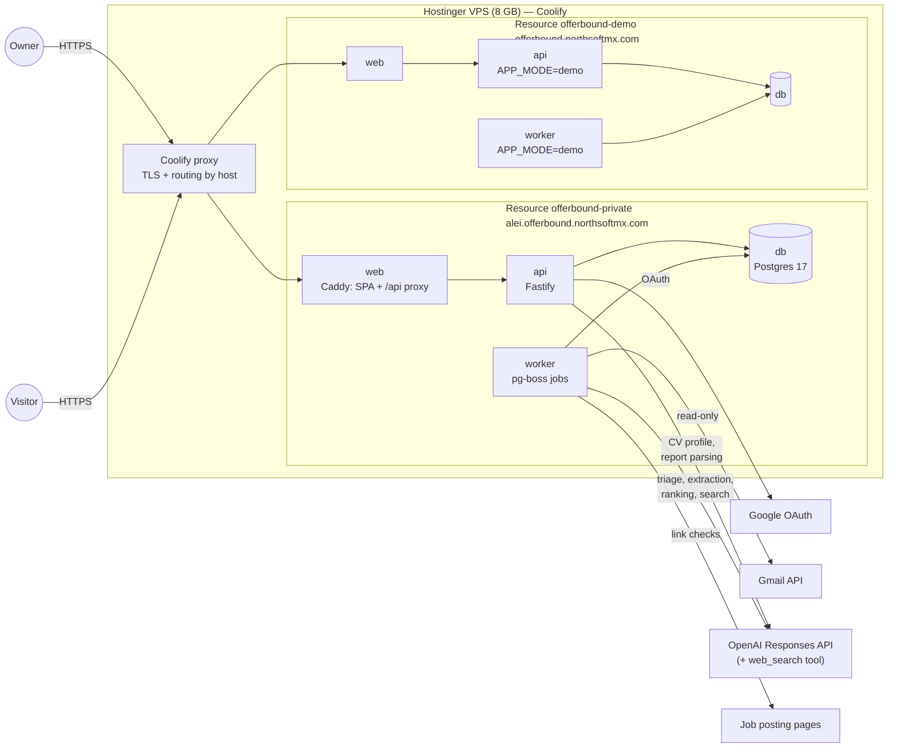
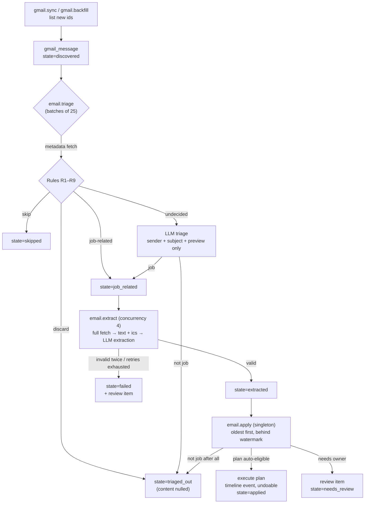
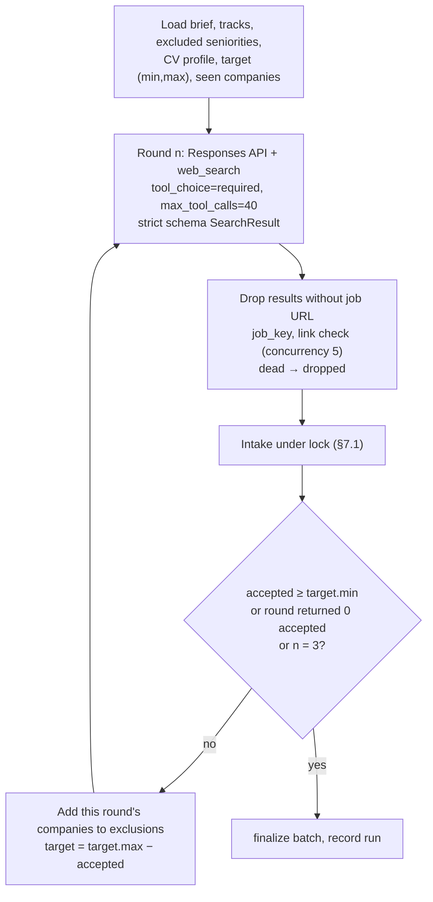

# Offerbound — Technical Specification

| | |
|---|---|
| Status | **Approved** (2026-10-29) |
| Version | 1.0 (2026-10-29) |
| Requirements | [PRD](PRD.md) (F-x, AC-x.y) |
| Data | [DATA_MODEL](DATA_MODEL.md) |
| Security | [SECURITY](SECURITY.md) |

This document is written so an implementation agent can build Offerbound without making product or architecture decisions. Where a value is configurable, the default is given. Anything still open is in [OPEN_QUESTIONS](OPEN_QUESTIONS.md) with a default that lets work continue.

---

## 1. Architecture overview



**Processes** (one image for `api` and `worker`, one for `web`):

| Service | Responsibility |
|---|---|
| `web` | Serves the built React SPA; reverse-proxies `/api/*`, `/health`, `/ready` to `api:3000`. Only service with a public domain. |
| `api` | HTTP API, auth, sessions, synchronous OpenAI calls (CV profile, report parsing), runs migrations on start. |
| `worker` | All background work through pg-boss: Gmail sync, email pipeline, lead checks and ranking, search agent, timers, backups, demo reset. |
| `db` | Postgres 17. Application tables (Prisma) and the `pgboss` schema (managed by pg-boss). Private network only. |

Web and API share one origin, so there is no CORS and the session cookie is first-party (S-3).

## 2. Repository and stack

```
offerbound/
├─ apps/
│  ├─ api/                 Fastify API + worker entry points (src/server.ts, src/worker.ts)
│  │  ├─ src/auth/         Google OAuth, sessions, CSRF guard
│  │  ├─ src/gmail/        Gmail client, sync, backfill, MIME/ics parsing
│  │  ├─ src/pipeline/     triage, extract, apply (executes domain plans)
│  │  ├─ src/leads/        intake, link check, ranking, search agent, report parsing
│  │  ├─ src/llm/          LlmProvider interface, OpenAiProvider, FakeLlmProvider, pricing
│  │  ├─ src/jobs/         pg-boss registration, schedules, handlers
│  │  ├─ src/routes/       one file per resource (§10)
│  │  └─ src/demo/         demo seed, fake mailbox, simulate-email
│  └─ web/                 React + Vite SPA, Caddyfile, Dockerfile
├─ packages/
│  ├─ contracts/           zod schemas: API DTOs, LLM output schemas, settings schema
│  └─ domain/              pure TypeScript, no I/O: canonical job keys, company normalisation,
│                          matching, status mapping and transitions, change plans, intake rules,
│                          timers, triage rules
├─ prisma/                 schema.prisma, migrations/
├─ fixtures/
│  ├─ emails/              labelled synthetic emails (tests, eval, demo)
│  ├─ leads/               synthetic search-agent outputs
│  └─ demo/                demo seed (fictional companies)
├─ scripts/                eval runner, backup/restore helpers
├─ private/                git-ignored: real exports, private eval sets
├─ docs/
├─ compose.yaml            local dev Postgres
├─ compose.prod.yaml       production stack (Coolify)
└─ .github/workflows/ci.yml
```

| Concern | Choice | Note |
|---|---|---|
| Runtime | Node ≥ 22, TypeScript strict, ESM | Same as MTGRulesLawyer |
| Package manager | pnpm 9 workspaces | `packageManager: pnpm@9.15.9` |
| API | Fastify 5, `@fastify/cookie`, `@fastify/rate-limit`, `@fastify/multipart` | |
| Validation | zod (shared in `packages/contracts`) | Request/response and LLM outputs |
| ORM | Prisma 6.19 | Same as MTGRulesLawyer |
| Queue | pg-boss (current major) | Postgres-backed; no Redis (S-2) |
| Google | `google-auth-library`, `@googleapis/gmail` | |
| OpenAI | `openai` ^6, Responses API, strict JSON schema outputs | Pattern from MTGRulesLawyer `ai/openai.ts` |
| Email parsing | `html-to-text`, `ical.js` | |
| CV parsing | `pdf-parse` (PDF), `mammoth` (DOCX) | |
| Domains | `tldts` (registrable domain) | |
| Logging | pino (Fastify default) with redaction | |
| Web | React 19, Vite, React Router, TanStack Query | Visual system defined in Phase 3 (DESIGN_SPEC) |
| Tests | Vitest, Testing Library; Postgres service in CI | Playwright smoke in Release 1.1 |
| Lint/format | ESLint 9 flat config, Prettier | Same config style as MTGRulesLawyer |

## 3. Deployment

### 3.1 Coolify resources

Two **Docker Compose** resources from `github.com/aleiruiz/offerbound`, branch `main`, compose file `/compose.prod.yaml`, created the same way as MTGRulesLawyer (`docs/deploy.md` in that repo).

| Resource | Domain on service `web` | Env |
|---|---|---|
| `offerbound-private` | `https://alei.offerbound.northsoftmx.com` | `APP_MODE=private` + secrets |
| `offerbound-demo` (Release 1.1) | `https://offerbound.northsoftmx.com` | `APP_MODE=demo`, no secrets |

`compose.prod.yaml` services: `db` (postgres:17-alpine, volume `postgres-data`, healthcheck `pg_isready`), `api` (build `apps/api/Dockerfile`, command `node dist/server.js`, healthcheck `GET /health`), `worker` (same image, command `node dist/worker.js`, `depends_on: api: service_healthy` so migrations have run), `web` (build `apps/web/Dockerfile`: Vite build → Caddy). Volume `backups` mounted at `/backups` in `worker`. No service publishes a port; Coolify's proxy reaches `web` on the Docker network.

The `api` image includes `postgresql17-client` for `pg_dump` (used by `worker`).

### 3.2 DNS (GoDaddy, owner task)

`A` records for host `offerbound` and host `alei.offerbound` → VPS IP. Coolify issues certificates per host.

### 3.3 Google Cloud setup (owner task, day 1)

1. Create project *Offerbound*; enable the Gmail API.
2. OAuth consent screen (*Google Auth Platform → Branding/Audience*): External; app name *Offerbound*; support email; homepage `https://offerbound.northsoftmx.com`; authorised domain `northsoftmx.com` (verify through Search Console with a GoDaddy TXT record if asked).
3. Data access: add `openid`, `email`, `profile`, `.../auth/gmail.readonly`.
4. Audience: **Publish app** → *In production* (avoids 7-day refresh tokens; the app stays unverified — D5).
5. Credentials → OAuth client ID → Web application. Authorised redirect URI: `https://alei.offerbound.northsoftmx.com/api/v1/auth/google/callback`. For local development also `http://localhost:5173/api/v1/auth/google/callback`.
6. Put client ID/secret in the private resource's environment (runtime-only).
7. **De-risk on day 1:** run the consent flow once against a minimal build to confirm Google shows the unverified-app screen and grants `gmail.readonly` (OQ-1).

### 3.4 Environment variables

Runtime-only unless marked *build*. ✗ = must be absent (demo refuses to start if present — AC-16.1). In demo an empty value of a forbidden variable counts as absent, so the demo deploys from the same compose file.

| Variable | Private | Demo | Default / example | Purpose |
|---|---|---|---|---|
| `APP_MODE` | `private` | `demo` | — | Mode switch |
| `PUBLIC_BASE_URL` | required | required | `https://alei.offerbound.northsoftmx.com` | Redirects, cookies |
| `DATABASE_URL` | required | required | from compose | |
| `OWNER_EMAIL` | required | ✗ | — | The only Google account allowed |
| `USER_TIMEZONE` | `America/Monterrey` | same | `America/Monterrey` | Day boundaries, schedules, display |
| `HOME_COUNTRY` | `MX` | `MX` | `MX` | "Remote from home country" eligibility |
| `GOOGLE_CLIENT_ID`, `GOOGLE_CLIENT_SECRET` | required | ✗ | — | OAuth |
| `TOKEN_ENCRYPTION_KEY` | required | ✗ | 32 random bytes, base64 | AES-256-GCM for Google tokens |
| `OPENAI_API_KEY` | required | ✗ | — | Dedicated OpenAI project *offerbound* |
| `OPENAI_MODEL_TRIAGE` / `_EXTRACT` / `_RANK` / `_SEARCH` / `_PROFILE` | optional | ✗ | see §8.2 | Model per purpose |
| `OPENAI_REASONING_EFFORT_*` (same suffixes) | optional | ✗ | triage `low`, extract `low`, rank `low`, search `medium`, profile `low` | |
| `AI_PRICING` | required | ✗ | JSON `{ "<model>": { "inputPerMTokMicros": n, "cachedInputPerMTokMicros": n, "outputPerMTokMicros": n } }` | Cost accounting |
| `AI_WEB_SEARCH_COST_PER_CALL_MICROS` | required | ✗ | from OpenAI pricing page | |
| `GMAIL_BACKFILL_SINCE` | optional | ✗ | `2026-09-01` | First sync start date |
| `GMAIL_SYNC_INTERVAL_MINUTES` | optional | ✗ | `5` | |
| `SEARCH_MAX_TOOL_CALLS_PER_ROUND` | optional | ✗ | `40` | |
| `SEARCH_MAX_ROUNDS` | optional | ✗ | `3` | |
| `BACKUP_RETENTION_DAYS` | optional | ✗ | `14` | |
| `TRUSTED_PROXY_IPS` | optional | optional | Docker private ranges | Client IP for rate limits |
| `LOG_LEVEL` | optional | optional | `info` | |

The private instance validates all required variables at start with zod and exits with a list of what is missing.

## 4. Authentication and sessions (F1)

```mermaid
sequenceDiagram
  participant B as Browser
  participant A as api
  participant G as Google
  B->>A: GET /api/v1/auth/google/start
  A-->>B: 302 to Google (state + nonce cookie, 10 min)
  B->>G: consent (openid email profile gmail.readonly, offline)
  G-->>B: 302 /api/v1/auth/google/callback?code&state
  B->>A: callback
  A->>G: exchange code (client secret)
  A->>A: verify id_token: aud, iss, exp, nonce, email_verified, email == OWNER_EMAIL
  alt not the owner
    A-->>B: 403 page "This Offerbound instance is private" (nothing stored)
  else owner
    A->>A: upsert gmail_connection (encrypt tokens, record scopes)
    A->>A: create session (random 32 bytes; store SHA-256)
    A-->>B: 302 /onboarding or /today, Set-Cookie ob_session
  end
```

- Auth request parameters: `access_type=offline`, `include_granted_scopes=true`, `prompt=consent` when no refresh token is stored, otherwise `prompt=select_account`.
- If the token response has no refresh token and none is stored, the connection status is `needs_reauth` and the next sign-in forces `prompt=consent`.
- If the granted scopes lack `gmail.readonly`, connection status `missing_scope` (AC-2.2).
- Cookie `ob_session`: `HttpOnly; Secure; SameSite=Lax; Path=/`; 30 days; renewed when < 7 days remain (AC-1.4).
- CSRF: all `POST/PUT/PATCH/DELETE` require header `X-Offerbound-Request: 1` (S-4). The SPA's fetch wrapper always adds it.
- Rate limits: auth routes 20/min/IP; everything else 300/min/IP (private); demo mutations 30/min/IP.
- Demo mode: no auth routes; every request acts as the demo owner.

## 5. Email pipeline (F2, F3)

### 5.1 Flow



### 5.2 Sync and backfill

**Backfill** (`gmail.backfill`, started by *Start syncing*, AC-2.3):
1. `users.getProfile` → store `historyId` as the incremental starting point **before** listing (nothing between listing and incremental sync is missed).
2. `users.messages.list` with `q = "after:{YYYY/MM/DD of GMAIL_BACKFILL_SINCE minus 1 day} -in:spam -in:trash -in:drafts"`, `maxResults=500`, paging; after each page insert ids as `discovered` (ignore conflicts) and save the page token on `gmail_connection` so a restart resumes.
3. Messages with `internal_date` before `GMAIL_BACKFILL_SINCE` (owner time zone) are marked `skipped` at triage.
4. When paging ends, `backfill_state = done`; incremental sync takes over.
5. If the retries are used up, `backfill_state = failed` and the owner sees a failed first sync. *Sync now* restarts a failed backfill (it resumes from the saved page token), because incremental sync cannot fill in what the backfill did not list.

**Incremental** (`gmail.sync`, every `GMAIL_SYNC_INTERVAL_MINUTES`, singleton; also *Sync now*):
1. `users.history.list(startHistoryId, historyTypes=["messageAdded"])`, all pages → insert new ids as `discovered`.
2. Store the response's latest `historyId` and `last_sync_at` only after inserts commit, and by compare-and-set (`UPDATE … WHERE history_id = {the start point}`), so a run that raced a newer one cannot move it backwards.
3. HTTP 404 on history (expired start point) → set `history_id` from `getProfile`, then list `after:{newest processed internal_date − 1 day}` and insert as `discovered` (duplicates ignored) (AC-2.7).
4. `invalid_grant` on token refresh → `status = needs_reauth`, stop scheduling sync until reconnect (AC-2.6).
5. 429/5xx → pg-boss retry with backoff (base 60 s, ×2, 3 retries); `last_sync_error` set and shown.

Gmail refresh tokens are also invalidated when the Google account password changes; this surfaces as `invalid_grant` and is handled the same way.

### 5.3 Triage rules (stage 1a, pure function in `packages/domain`)

Input: labels, direction, thread id, headers `From`, `To`, `Cc`, `Subject`, `Date`, `List-Id`, preview, plus lookups (linked threads, company domains, contact emails, ATS/alert sender lists, ignore list). First matching rule wins.

| Rule | Condition | Decision |
|---|---|---|
| R1 | Label `DRAFT`, `SPAM`, `TRASH` or `CHAT`; or `internal_date` before backfill start | `skipped` |
| R2 | Thread id is linked to an application or lead | job-related |
| R3 | Outgoing (`SENT` label): any recipient is a known contact or at a known company domain → job-related (`direction=outbound`); otherwise → `triaged_out` **(never sent to the LLM)** | as stated |
| R4 | Sender domain is an ATS domain (list below) | job-related |
| R5 | Sender is a job-alert sender (list below) | job-related, hint `job_alert` |
| R6 | Sender email is a known contact, or sender's registrable domain is a known company domain | job-related |
| R7 | Sender email or domain is on the owner's ignore list | `triaged_out` |
| R8 | Gmail category `CATEGORY_PROMOTIONS` or `CATEGORY_FORUMS` | `triaged_out` |
| R9 | Anything else | LLM triage (§5.4) |

**ATS domains** (registrable domain match; extendable in code): `greenhouse.io`, `greenhouse-mail.io`, `lever.co`, `ashbyhq.com`, `myworkday.com`, `myworkdayjobs.com`, `smartrecruiters.com`, `workable.com`, `workablemail.com`, `personio.com`, `personio.de`, `icims.com`, `jobvite.com`, `bamboohr.com`, `recruitee.com`, `teamtailor.com`, `hirehive.com`, `successfactors.com`, `taleo.net`, `breezy.hr`, `pinpointhq.com`, `rippling.com` (only `ats.rippling.com` senders), `dover.com`, `gem.com`.

**Job-alert senders**: `jobalerts-noreply@linkedin.com`, `jobs-noreply@linkedin.com`, `jobs-listings@linkedin.com`, `alert@indeed.com`, `noreply@indeed.com`, `noreply@glassdoor.com`, `alerts@glassdoor.com`, `noreply@wellfound.com`, `talent@otta.com`, `noreply@welcometothejungle.com`.

LinkedIn messaging senders (`messages-noreply@linkedin.com`, `inmail-hit-reply@linkedin.com`) are **not** auto-accepted; they go to R9 because many are personal.

### 5.4 LLM triage (stage 1b)

- One call per batch of up to 25 undecided messages. Input per message: `id`, sender name, sender address, subject, Gmail preview (≤ 300 chars). Nothing else.
- Output schema `TriageResult`: `{ results: [{ id, jobRelated: boolean, confidence: number }] }`.
- Proceed to extraction when `jobRelated = true`, or `jobRelated = false` with `confidence < 0.70` (recall first; extraction can still say *not job-related*).
- Instructions: job-related = anything about the owner's job search (applications, interviews, assessments, offers, rejections, recruiter contact, job alerts, scheduling for any of these). Newsletters about careers in general, course marketing and social notifications are not.
- On triage failure after retries, the batch's messages stay `discovered` and are retried by the next sweep; after 5 failed sweeps a message becomes `failed` with a review item.

### 5.5 Extraction (stage 2)

1. `users.messages.get(format=full)`. Walk MIME parts:
   - `text/plain` preferred; else `text/html` → `html-to-text` (links kept as `text [url]`).
   - `text/calendar` parts and `.ics` attachments ≤ 256 KB → `ical.js`: for each `VEVENT`: `UID`, `DTSTART`, `DTEND`, `SUMMARY`, `LOCATION`, `URL`, first `https://` link in `DESCRIPTION`, `ORGANIZER`, and `METHOD` (`REQUEST`, `CANCEL`).
   - Other attachments are ignored.
2. Strip quoted history: cut at the first line matching `^On .+ wrote:$`, `^El .+ escribió:$`, `^-----Original Message-----`, `^From: .+` after a blank line, or a run of lines starting with `>`. Collapse whitespace. Truncate to 15,000 characters.
3. Store `body_text` (job-related messages only), `from_*`, `to_emails`, `subject`, `snippet`.
4. Call extraction with: headers, `Date`, the owner time zone, the parsed calendar events, and the body.
5. Output schema `Extraction` (strict; every field present, nullable where noted):

```ts
{
  category: "application_confirmation" | "rejection" | "interview_invite" | "interview_reschedule"
          | "interview_cancellation" | "assessment" | "offer" | "recruiter_outreach" | "job_alert"
          | "status_update_other" | "candidate_outbound" | "not_job_related",
  confidence: number,                         // 0..1, for category + company + role together
  company: { name: string, websiteDomain: string | null } | null,
  role: { title: string, seniority: Seniority | null } | null,
  jobUrl: string | null,                      // official posting if present
  contact: { name: string | null, email: string | null, title: string | null, isAgency: boolean } | null,
  interview: {
    kind: InterviewKind,
    startsAt: string | null,                  // ISO 8601 with offset
    endsAt: string | null,
    timezone: string | null,                  // IANA zone as stated in the email, if any
    meetingUrl: string | null, schedulingUrl: string | null,
    location: string | null, interviewers: string[]
  } | null,
  assessment: { deadline: string | null, url: string | null } | null,
  leads: Array<{                              // job_alert and recruiter_outreach only; else []
    company: string, title: string, jobUrl: string | null, locationText: string | null,
    country: string | null, workMode: WorkMode, compensationText: string | null, postedAt: string | null
  }>,
  summary: string,                            // ≤ 140 chars, English, for the timeline
  language: "en" | "es" | "other"
}
```

6. Instructions include: resolve relative dates ("next Tuesday 3pm EST") against the email `Date` header and output ISO with offset; lower confidence when ambiguous; prefer calendar data when given; `candidate_outbound` for messages the owner sent; never invent a job URL.
7. zod-validate; on failure retry once with the validation error appended; then `failed` + review item *Extraction failed* (AC-3.6).

### 5.6 Apply ordering (AC-3.8)

`email.apply` runs as a singleton every time an extraction finishes and on a 1-minute sweep. It processes `extracted` messages ordered by `internal_date` ascending, but only those **older than the watermark**: the minimum `internal_date` among messages still `discovered` or `job_related`. `failed`, `skipped` and `triaged_out` messages do not hold the watermark. Each message is applied in its own transaction under the intake lock (§6.8).

## 6. Domain logic (`packages/domain`, pure and unit-tested)

### 6.1 Canonical job keys

`jobKey(url)` returns a stable identity used for duplicate detection; the original URL is kept for display.

| Host pattern | Key |
|---|---|
| `jobs.ashbyhq.com/{org}/{uuid}[/…]` | `ashby:{org}:{uuid}` |
| `jobs.lever.co/{org}/{uuid}[/apply]` | `lever:{org}:{uuid}` |
| `boards.greenhouse.io/{org}/jobs/{id}`, `job-boards.greenhouse.io/{org}/jobs/{id}`, any URL with `gh_jid={id}` | `greenhouse:{org or host}:{id}` |
| `{tenant}.wd{n}.myworkdayjobs.com/…/{slug}_{reqId}` | `workday:{tenant}:{reqId}` |
| `{org}.jobs.personio.{tld}/job/{id}` | `personio:{org}:{id}` |
| `jobs.smartrecruiters.com/{company}/{id}[-…]` | `smartrecruiters:{company}:{id}` |
| `apply.workable.com/{org}/j/{code}` | `workable:{org}:{code}` |
| `linkedin.com/jobs/view/{id}`, `/comm/jobs/view/{id}`, `?currentJobId={id}` | `linkedin:{id}` |
| `indeed.com/…?jk={id}` | `indeed:{id}` |
| anything else | `url:{lowercased host without www}{path without trailing slash}` (query and fragment dropped except known id params) |

Tracking parameters (`utm_*`, `gh_src`, `lever-source`, `source`, `ref`, `refId`, `trk`, `trackingId`, `src`) are always dropped. `atsSlug(url)` returns `{ats}:{org}` for Ashby, Lever, Greenhouse, Workday, Personio, SmartRecruiters, Workable, Recruitee and Teamtailor subdomains.

### 6.2 Company resolution

`normalizeCompanyName(name)`: NFKD, strip diacritics, lowercase, `&` → `and`, remove punctuation, drop trailing legal/generic suffixes (`inc`, `llc`, `ltd`, `limited`, `gmbh`, `ag`, `bv`, `nv`, `ab`, `as`, `aps`, `oy`, `sa`, `sas`, `sl`, `srl`, `spa`, `plc`, `corp`, `corporation`, `co`, `company`, `sa de cv`, `s de rl de cv`, `pty`, `pte`, `kk`), collapse spaces.

Resolution order (first hit wins):
1. Sender email is a known contact → its company.
2. Sender registrable domain (`tldts`) is in a company's `domains`, unless it is a generic mailbox domain (`gmail.com`, `googlemail.com`, `outlook.com`, `hotmail.com`, `live.com`, `yahoo.com`, `icloud.com`, `proton.me`, `protonmail.com`) or an ATS / job-board domain.
3. `atsSlug(jobUrl)` is in a company's `ats_slugs`.
4. `normalizeCompanyName(extracted name)` equals a company's `normalized_name` or is in its `aliases`.
5. Otherwise create a company with the extracted name, the sender domain (if not generic/ATS), the extracted website domain, and the ATS slug.

When a new company is created and an existing company's normalised name has token-set Jaccard ≥ 0.8 with it, or one name contains the other as whole words, a review item *Possible duplicate company* is created (the change still applies).

**Groups.** `company.group_id` points to the root company of a corporate group. "Company already seen" (§7.1) checks every company in the same group. Groups are set from the review item (*Same group*) or company edit.

### 6.3 Status mapping and transitions

Category → target status:

| Category | Target |
|---|---|
| `application_confirmation` | Applied |
| `interview_invite` with kind `recruiter_screen` | Screening |
| `interview_invite` (any other kind) | Interviewing |
| `assessment` | Assessment |
| `offer` | Offer |
| `rejection` | Rejected |
| `interview_reschedule`, `interview_cancellation`, `status_update_other`, `candidate_outbound`, `recruiter_outreach` (on an existing application) | no status change |

Allowed **automatic** transitions (rows = current, ✓ = applied automatically, · = no change (timeline only), R = review item *Unexpected status change*):

| current \ target | Applied | Screening | Assessment | Interviewing | Offer | Rejected |
|---|---|---|---|---|---|---|
| Applied | · | ✓ | ✓ | ✓ | ✓ | ✓ |
| Screening | · | · | ✓ | ✓ | ✓ | ✓ |
| Assessment | · | · | · | ✓ | ✓ | ✓ |
| Interviewing | · | · | · | · | ✓ | ✓ |
| Offer | · | · | · | · | · | R |
| Accepted | · | · | · | · | · | · |
| Rejected | R | R | R | R | R | · |
| Withdrawn | · | · | · | · | · | · |
| Abandoned | ✓ | ✓ | ✓ | ✓ | ✓ | ✓ |

Abandoned + an email that implies no status (e.g. `status_update_other`) → reopen to `status_before_abandon` (AC-7.5). Accepted and Withdrawn are only set manually. Manual status changes ignore this table.

### 6.4 Matching an email to an application

1. Thread id linked (`thread_link`) → that application/lead.
2. `jobKey(jobUrl)` equals an application's `job_key` → it.
3. Resolve company (§6.2). Among that company's (and group's) applications not in a terminal status (Accepted, Withdrawn) — rejected included, for the *unexpected transition* case:
   - exactly one → it;
   - several → pick by role title token-set Jaccard ≥ 0.6 against the extracted role; exactly one passes → it; otherwise *Ambiguous match* with all candidates.
4. No application:
   - category `application_confirmation`, `rejection`, `interview_invite`, `assessment` or `offer` → create an application (if a lead with the same `job_key`, or same company and role Jaccard ≥ 0.6, exists, convert that lead instead — AC-4.5);
   - otherwise (e.g. reschedule for an unknown application) → *Ambiguous match* with no candidates (owner can create or dismiss).
5. Successful matches add `thread_link(thread_id → application)`, so later messages hit rule 1.

Categories that are not about an application follow their own path:
- `job_alert` → lead intake (§7.1) with the extracted `leads[]`; each lead's company is resolved from its own name and job link, never from the sender.
- `recruiter_outreach` → if the resolved company has an application in Applied, Screening, Assessment, Interviewing or Offer, the email is attached to it as `email_received` (company clock updated, no lead); otherwise one lead via intake with source `gmail_recruiter` and a `thread_link` to the lead.
- `candidate_outbound` → matched like any email; if nothing matches, it is recorded as `triaged_out` (content nulled).
- `not_job_related` → `triaged_out` (content nulled).

### 6.5 Change plans

`planChanges(snapshot, message, extraction, settings) → ChangePlan` is pure. The worker loads a snapshot (matched entities and versions, seen-company set, settings), calls it, then either executes the plan or stores it in a review item.

```ts
type ChangePlan = {
  operations: Operation[];          // create_company, create_contact, create_application,
                                    // update_application, convert_lead, upsert_interview,
                                    // cancel_interview, create_leads, link_thread, timeline
  autoApply: boolean;
  review?: { kind: ReviewKind; reasons: string[]; candidates?: Candidate[] };
  confidence: number;
};
```

`autoApply = confidence ≥ settings.autoApplyMinConfidence && no review condition`. Every executed plan writes one `event` per affected record with a `change_set` (`entity`, `id`, `created`, `before`, `after`, `versionAfter`) used by undo. Resolving a review item re-runs `planChanges` against the current snapshot with the owner's choice and executes it through the same path (AC-5.3).

Company-clock effects are part of the plan: any inbound message attributed to an application sets `last_company_activity_at = max(current, internal_date)`, clears `follow_up_due`, and reopens Abandoned. Outbound messages set `last_outbound_at`; if `follow_up_due` was true they record a follow-up (AC-7.3): `follow_up_due = false`, `follow_up_done_at = internal_date`, `follow_up_done` event, and `daily_activity.follow_ups + 1` on the owner-local date of `internal_date`. *Mark followed up* does the same with the current time.

### 6.6 Undo (AC-4.3, AC-4.4)

`POST /events/:id/undo`: undo works per event. A plan that changes several records writes one event per affected record, and each event carries only its own slice of the change set (the entries for the records it owns, such as one lead and the company created for it). Undoing one event leaves the plan's other events and records alone. Under the intake lock, for every entry in the event's `change_set`, compare the record's current `version` with `versionAfter`. Any mismatch → `409 changed_since`. Otherwise delete created applications, interviews and leads (and their events), restore `before` fields, bump versions, set `undone_at`, write an `undone` event, and create review item *Undone change* for the source message. Created companies and contacts are deleted only if nothing else references them; otherwise they stay. A lead converted by the undone change returns to its previous status.

Undo is also refused with `409 changed_since` (nothing is changed) when the event created an application that has later children: an event from another email or an owner edit, or an interview that a later change added or edited. Events and interviews written by the same email's plan don't count as later. Likewise it is refused when a lead the event created has been converted to an application since.

Exception to the version rule: undoing a `lead_created` event deletes the lead when its status is `new` or `suppressed` and it has no application, with no version comparison, because the link check and the ranking bump the lead's `version` after it is created. Owner actions on the lead (shortlist, dismiss, mark applied) change its status and so block the undo.

Events of type `imported`, `undone`, and owner edits cannot be undone.

When an application is deleted for any reason (undo, merge), its lead — if any — returns to `shortlisted` with `application_id = null`.

### 6.7 Timers (F7)

`timers.tick` every 15 minutes under the intake lock. **Gate:** it does nothing to applications until `gmail_connection.backfill_state = done` and no `gmail_message` in `discovered`, `job_related` or `extracted` has `internal_date` older than one hour (AC-7.6); interview completion runs regardless. For applications in Applied, Screening, Assessment, Interviewing:

```
clock = max(last_company_activity_at ?? applied_at ?? created_at, clock_restarted_at)
if now − clock ≥ abandonDays:
    status_before_abandon = status; status = Abandoned; follow_up_due = false   (event, undoable)
else if now − clock ≥ followUpDays and (follow_up_done_at is null or now − max(follow_up_done_at, clock) ≥ followUpDays):
    follow_up_due = true (follow_up_due_since = now if it was false)
```

`clock_restarted_at` is not a column. It is read from events: the latest `status_changed` event whose `fromStatus` is `abandoned` (an owner reopening an application), or the `undone_at` of an `abandoned` event (an undone abandonment). Either restarts the abandonment clock, so the application gets a fresh window instead of being abandoned again on the next tick.

Applications imported from the sheet follow the same rules: an old imported application is abandoned on the first timers tick that finds the gate open.

Interviews `scheduled` with `coalesce(ends_at, starts_at + 60 min) < now` → `completed`.

### 6.8 Concurrency

All writes produced by the pipeline, intake, imports, search runs, timers, undo and review resolution run inside `pg_advisory_xact_lock(hashtext('offerbound.intake'))`. Owner edits from the UI do not take the lock; they use optimistic concurrency (`version` in the PATCH body → `409 version_conflict`). This makes "company already seen" and job-key uniqueness race-free without complex locking.

### 6.9 Interview upsert

For `interview_invite`, `interview_reschedule` and `interview_cancellation` on a matched application:
1. A calendar event with a `UID` equal to an interview's `ics_uid` → that interview (update times, link, location; `METHOD:CANCEL` → `cancelled`).
2. Else, reschedule/cancellation → the application's next `scheduled` or `to_schedule` interview of the same kind; else its next upcoming interview of any kind; else (reschedule only) create one.
3. Else, invite → if the application has a `to_schedule` interview of the same kind, fill it in (`scheduled`); otherwise create a new interview (`scheduled` when a start time is known, `to_schedule` with the scheduling link otherwise).
4. Calendar times override extracted times (S-11). Times are stored in UTC; `timezone_hint` keeps the zone stated in the invite.

## 7. Leads (F9–F12)

### 7.1 Intake

Every lead source produces an **intake batch** (`intake_batch_id`): one search run, one alert email, one recruiter email, one pasted report, one sheet import, or one manual entry.

Synchronous intake (under the lock), per incoming lead:
1. Compute `job_key`; if absent and source is the search agent → discard (AC-10.4).
2. `job_key` exists on any lead or application → discard, count `duplicates`.
3. Resolve company (§6.2).
4. *Company already seen*: the company or its group has any lead or application **created before this batch** → `status=suppressed, suppressed_reason=company_already_seen`; except source `gmail_recruiter` → keep `new` with `company_seen_before=true`. Skipped for `sheet_import` and `manual`.
5. Seniority known and in `excludedSeniorities` → `suppressed, excluded_seniority`.
6. Search-agent leads arrive already link-checked and ranked (§7.3): eligibility `no` → `suppressed, ineligible`; otherwise `new` with `pipeline_state=ready`.
7. Imported leads with sheet status *Cancelled* → `dismissed`, `pipeline_state=ready`.
8. Everything else → `new`, `pipeline_state=checking`.

Asynchronous (not used for search-agent leads, which are checked and ranked inside the run):
- `leads.check` (per lead): link check (§7.2). Dead → the lead is **deleted** (so its company does not count as reported) and the batch's `dead` counter incremented — except `sheet_import` leads, which become `dismissed` with reason `posting_closed` because they are history. Otherwise `pipeline_state=ranking`.
- `leads.rank` (batches of ≤ 10): ranking (§7.4), then `pipeline_state=ready`. Eligibility `no` → `suppressed, ineligible`.
- `leads.finalize` (when no lead of the batch is still `checking` or `ranking`): for every company with more than one `new` lead in the batch keep the highest `fit_score` (tie: newest `posted_at`, then first returned), mark the rest `suppressed, same_company_in_batch`. Skipped for `sheet_import` and `manual`. If a kept lead is later found dead, the best remaining `same_company_in_batch` lead of that company is moved back to `new` and checked.
- Only leads with `pipeline_state=ready` appear in the New list (AC-12.4 ordering).

### 7.2 Link check (AC-9.8)

`GET` with redirects (max 5), timeout 10 s, user agent `Offerbound/1.0 (+https://offerbound.northsoftmx.com)`, body read up to 1 MB.
- Host `linkedin.com` → `unverifiable` (no request).
- 404 or 410 → `dead`.
- 200 and the HTML text contains a closed marker (`no longer accepting`, `job is no longer available`, `position has been filled`, `this job has expired`, `job not found`, `ya no está disponible`, `vacante cerrada`), or the final URL is the bare board root of a known ATS (e.g. `jobs.ashbyhq.com/{org}` with no job id) → `dead`.
- 200 otherwise → `verified`; store the first 8,000 characters of the page text as `page_excerpt` for ranking.
- Anything else (timeouts, 403, 5xx) → `unverified`.

### 7.3 Search agent (F10)

`search.run` (cron at `search.runTime` in `USER_TIMEZONE`, when enabled; or *Run now*; singleton → `409 already_running`).



Request (per round), following MTGRulesLawyer's `ai/openai.ts` pattern: `tools: [{ type: "web_search" }]`, `tool_choice: "required"`, `max_tool_calls: SEARCH_MAX_TOOL_CALLS_PER_ROUND`, `include: ["web_search_call.action.sources"]`, `text.format: json_schema strict`.

Prompt inputs: today's date; home country; the brief (verbatim); CV profile JSON; tracks (key, label, priority); excluded seniorities; the exclusion list (every seen company name and alias, grouped by corporate group); the number of leads wanted this round. Fixed instructions: return only currently open postings with an official link (company careers site or ATS); verify modality, eligibility, compensation and visa from the posting; label any compensation not stated in the posting as an estimate and name its basis; at most one posting per company; never return excluded companies; return fewer results rather than inventing any.

Output schema `SearchResult`: `{ leads: SearchLead[], notes: string }` where `SearchLead` = the lead fields of §7.4's `Ranking` plus `company`, `companyDomain`, `title`, `jobUrl`, `locationText`, `country`, `postedAt`, `evidenceUrls: string[]`.

Run record: trigger, status (`running`, `succeeded`, `partial` — target min not reached, `failed`), rounds, returned, accepted, suppressed, duplicates, dead, web search calls, cost, error. A run older than 30 minutes still `running` at worker start is marked `failed` (*interrupted*).

### 7.4 Ranking (F12)

Input: brief, CV profile, tracks, home country, and per lead: company, title, location, work mode, compensation text, page excerpt (if any). Output `Ranking` per lead:

```ts
{
  leadRef: string,
  track: string | null,              // a configured track key
  fitScore: number,                  // 0..100
  fitReason: string,                 // ≤ 160 chars
  gaps: string[],                    // ≤ 3 short items vs the CV
  seniority: Seniority,
  workMode: WorkMode,
  remoteFromHomeCountry: "yes" | "no" | "unknown",
  sponsorship: "yes" | "no" | "unknown",
  relocation: "yes" | "no" | "unknown",
  compensation: { min: number | null, max: number | null, currency: string | null,
                  period: "year" | "month" | "hour" | null, isEstimate: boolean, basis: string | null },
  eligible: "yes" | "no" | "unknown",
  eligibilityReason: string | null
}
```

### 7.5 CV profile (F11)

`POST /cv` (multipart, ≤ 5 MB, `application/pdf` or DOCX MIME). Extract text (`pdf-parse` / `mammoth`); fewer than 200 characters → `422 cv_no_text`. Call `cv_profile` synchronously (timeout 60 s) → schema `{ headline, yearsExperience, coreSkills[], secondarySkills[], domains[], recentRoles[{title, company, years}], leadership, languages[], location, workAuthorization }`. Store text + profile; previous profile `is_active=false`. On LLM failure store the text with `profile=null` and return `202` with `profileStatus: "failed"`; *Retry profile* re-runs it.

### 7.6 Report parsing (F9.4, Should)

`POST /leads/import/preview { text ≤ 50,000 chars }` → LLM `parse_report` (schema: `{ leads: SearchLead-like[] }`) → dry-run of synchronous intake → rows annotated `new | duplicate | company_already_seen | excluded_seniority`. `POST /leads/import/commit { previewId, keepRowIds[] }` → creates the batch; async steps as §7.1. Previews are stored for 1 hour.

## 8. LLM layer

### 8.1 Provider interface

```ts
interface LlmProvider {
  triage(batch: TriageInput[]): Promise<LlmResult<TriageResult>>;
  extract(input: ExtractInput): Promise<LlmResult<Extraction>>;
  rank(input: RankInput): Promise<LlmResult<{ rankings: Ranking[] }>>;
  search(input: SearchInput): Promise<LlmResult<SearchResult>>;
  parseReport(text: string): Promise<LlmResult<{ leads: ReportLead[] }>>;
  cvProfile(text: string): Promise<LlmResult<CvProfile>>;
}
type LlmResult<T> = { output: T; usage: { model; inputTokens; cachedInputTokens; outputTokens; webSearchCalls; latencyMs; requestId } };
```

- `OpenAiProvider` — Responses API, `text.format = json_schema strict` from the zod schemas in `packages/contracts`, per-purpose model and reasoning effort, `prompt_cache_key` per purpose, timeouts: triage 30 s, extract 45 s, rank 60 s, profile 60 s, parse 90 s, search 300 s per round. `status: "incomplete"` is an error.
- `FakeLlmProvider` — returns outputs from fixtures keyed by a SHA-256 of the normalised input; unknown input → deterministic fallback (`triage`: not job-related; `extract`: `status_update_other`, confidence 0.5; `search`: next unused fixture batch). Used by all tests and the demo.

Every call (success or failure) writes an `llm_call` row with computed cost: `(input − cached) × input price + cached × cached price + output × output price + webSearchCalls × search price`, in micro-dollars. Unknown model in `AI_PRICING` → cost `null` and a warning log.

### 8.2 Models

Default for every purpose: the model MTGRulesLawyer runs in production (`gpt-6-luna`, set per purpose through `OPENAI_MODEL_*`). Report parsing uses the extraction model. After the first evaluation run, each purpose is moved to the cheapest model that still meets the AC-17.4 bar (OQ-2). No code change is needed to switch.

### 8.3 Retries

pg-boss retries with exponential backoff (base 30 s): triage and extraction 4 retries, ranking 3, link checks 2. OpenAI 429 and 5xx retry; 400 does not. A search round that fails ends the run as `failed` (or `partial` if earlier rounds accepted leads); runs are not retried automatically.

## 9. Background jobs

| Queue | Trigger | Concurrency | Retries | Idempotency |
|---|---|---|---|---|
| `gmail.sync` | every 5 min (private), *Sync now* | singleton | 3 | inserts ignore existing ids; `history_id` is moved by compare-and-set |
| `gmail.backfill` | *Start syncing*; *Sync now* when the backfill is `failed`; resumes on worker start while `running` | singleton | 5 | page token persisted per page |
| `email.triage` | after sync/backfill inserts; 1-min sweep | 1, batches of 25 | 4 | state check before work |
| `email.extract` | per `job_related` message | 4 | 4 | singleton key = message id |
| `email.apply` | after each extraction; 1-min sweep | singleton | 3 | event unique key `(message_id, type, entity)` |
| `leads.check` | per new lead | 5 | 2 | skips leads not `checking` |
| `leads.rank` | when ≥ 1 lead `ranking`; batches of ≤ 10 | 2 | 3 | skips ranked leads |
| `leads.finalize` | when a batch has no `checking`/`ranking` leads | singleton | 3 | `finalized_at` on batch |
| `search.run` | daily at run time (owner TZ), *Run now* | singleton | 0 | one `running` row max |
| `timers.tick` | every 15 min | singleton | 1 | recomputes from state |
| `backup.nightly` | 03:30 owner TZ (private) | singleton | 2 | file name per date |
| `demo.reset` | hourly (demo) | singleton | 1 | full reseed |
| `maintenance.daily` | 04:00 owner TZ | singleton | 1 | deletes expired sessions and import previews; deletes `llm_call` rows older than 180 days |

pg-boss cron schedules use the `tz` option with `USER_TIMEZONE`. The worker registers schedules according to `APP_MODE`. `PUT /settings` re-registers the `search.run` schedule when `search.runTime` or `search.enabled` changes. `gmail.sync` is only scheduled once the owner has pressed *Start syncing* and the connection is `active`.

## 10. API

Base path `/api/v1`. JSON in and out. Session cookie required (private). Mutations need `X-Offerbound-Request: 1`.

**Errors:** `{ "error": { "code": string, "message": string, "fields"?: { [path]: string } } }`

| HTTP | Codes |
|---|---|
| 400 | `validation_failed` |
| 401 | `unauthenticated` |
| 403 | `not_owner`, `csrf_header_missing`, `demo_read_only` |
| 404 | `not_found` |
| 409 | `version_conflict`, `changed_since`, `already_running`, `duplicate_import`, `not_connected` |
| 413 | `too_large` |
| 422 | `cv_no_text`, `unsupported_file` |
| 429 | `rate_limited` |
| 500 | `internal_error` (unexpected failure) |
| 502 | `upstream_error` (OpenAI/Google) |
| 503 | `not_ready` |

**Pagination:** `?limit=` (default 50, max 200) `&cursor=` → `{ items: T[], nextCursor: string | null }`.

**Concurrency:** PATCH bodies carry `version`; stale → `409 version_conflict` with the current record.

### 10.1 Endpoints

| Method & path | Body / query | Response |
|---|---|---|
| `GET /auth/google/start` | — | 302 |
| `GET /auth/google/callback` | `code, state` | 302 |
| `POST /auth/logout` | — | 204 |
| `GET /me` | — | `Me` |
| `GET /gmail/status` | — | `SyncStatus` |
| `POST /gmail/start` | — | 202 `SyncStatus` (starts backfill; `409 already_running` if already started, `409 not_connected` when Gmail isn't connected) |
| `POST /gmail/sync` | — | 202 (`409 not_connected` when Gmail isn't connected or syncing hasn't been started) |
| `POST /gmail/disconnect` | — | 204 |
| `GET /today` | — | `Today` |
| `GET /nav-counts` | — | `NavCounts` (the four navigation badges) |
| `POST /daily-activity` | `{ kind: "outreach" \| "prep_minutes", amount: 1..240 }` | `DailyCounts` |
| `GET /applications` | `status[]`, `followUpDue`, `q`, `sort=last_activity\|applied\|status`, pagination | page of `ApplicationSummary` |
| `POST /applications` | `ApplicationCreate` | 201 `ApplicationDetail` |
| `GET /applications/:id` | — | `ApplicationDetail` |
| `PATCH /applications/:id` | `ApplicationPatch` (incl. `version`) | `ApplicationDetail` |
| `POST /applications/:id/follow-up-done` | — | `ApplicationDetail` |
| `POST /applications/:id/merge` | `{ intoId }` (Should) | `ApplicationDetail` of target |
| `POST /applications/:id/interviews` | `InterviewCreate` | 201 `Interview` |
| `GET /interviews` | `range=upcoming\|past`, pagination | page of `Interview` (with application summary) |
| `PATCH /interviews/:id` | `InterviewPatch` | `Interview` |
| `GET /leads` | `status=new\|shortlisted\|dismissed\|applied\|suppressed`, `track`, `q`, `sort=track_fit\|newest` (default `track_fit`: track priority, then fit score, then newest found; `newest`: newest found first), pagination | page of `Lead` |
| `POST /leads` | `LeadCreate` (manual) | 201 `Lead` |
| `PATCH /leads/:id` | `{ status?: "shortlisted"\|"dismissed"\|"new", dismissedReason?, notes?, version }` | `Lead` |
| `POST /leads/:id/mark-applied` | — | 201 `ApplicationDetail` |
| `POST /leads/:id/reconsider` | — | `Lead` |
| `POST /leads/rerank` | `{ scope: "new" }` | 202 |
| `POST /leads/import/preview` | `{ text }` (Should) | `ReportPreview` |
| `POST /leads/import/commit` | `{ previewId, keepRowIds }` (Should) | 202 `{ batchId }` |
| `GET /companies/exclusion-list` | — | `text/plain` (Should) |
| `PATCH /companies/:id` | `{ name?, aliases?, groupId?, version }` | `Company` |
| `POST /companies/:id/merge` | `{ intoId }` (Should) | `Company` |
| `GET /review-items` | `state=open\|resolved`, pagination | page of `ReviewItem` |
| `POST /review-items/:id/resolve` | `{ action, applicationId?, edits? }` | `ReviewItem` |
| `POST /events/:id/undo` | — | 200 `{ undone: true }` |
| `GET /messages/:id` | — | `MessageDetail` (body text) |
| `POST /messages/:id/reprocess` | — | 202 |
| `POST /import/sheet/preview` | multipart `file` (CSV ≤ 2 MB) | `SheetPreview` |
| `POST /import/sheet/commit` | `{ previewId }` | 201 `ImportSummary` |
| `GET /search/runs` | — | last 14 `SearchRun` |
| `POST /search/run` | — | 202 `SearchRun` / `409 already_running` |
| `GET /cv` | — | `CvProfile \| null` |
| `POST /cv` | multipart `file` | 201 `CvProfile` / 202 with `profileStatus: "failed"` |
| `POST /cv/retry-profile` | — | `CvProfile` |
| `GET /settings` | — | `Settings` |
| `PUT /settings` | `Settings` (full) | `Settings` |
| `GET /ai-usage` | — | `AiUsage` |
| `POST /data/purge-email-content` | `{ confirm: "DELETE" }` (Should) | 200 `{ messagesPurged }` |
| `POST /demo/simulate-email` | — (demo only) | 202 `{ messageId }` |
| `POST /onboarding/complete` | — | `Me` |
| `GET /health` (root, not under `/api/v1`) | — | 200 |
| `GET /ready` (root) | — | 200 / 503 |

### 10.2 Main DTOs (zod in `packages/contracts`)

```ts
Me = { mode: "private" | "demo"; email: string | null; onboardingCompleted: boolean; timezone: string }

SyncStatus = {
  connection: "not_connected" | "active" | "needs_reauth" | "missing_scope" | "disconnected";
  started: boolean; lastSyncAt: string | null; lastError: string | null;
  backfill: { state: "not_started" | "running" | "done" | "failed"; listed: number; processed: number };
  queue: { discovered: number; jobRelated: number; extracted: number; needsReview: number; failed: number };
}

ApplicationSummary = {
  id; version; company: { id; name }; title; status: ApplicationStatus; statusChangedAt;
  appliedAt: string | null; lastCompanyActivityAt: string | null; followUpDue: boolean;
  nextInterviewAt: string | null; workMode: WorkMode; country: string | null; source: ApplicationSource
}
ApplicationDetail = ApplicationSummary & {
  jobUrl: string | null; locationText; compensationText; sponsorshipText; notes;
  leadId: string | null; interviews: Interview[]; messages: MessageSummary[]; timeline: TimelineEvent[]
}
TimelineEvent = { id; type: EventType; occurredAt; actor: "system" | "owner" | "import";
                  summary: string; messageId: string | null; toStatus: ApplicationStatus | null;
                  undoable: boolean; undoneAt: string | null }
MessageSummary = { id; internalDate; direction; fromName; fromEmail; subject; summary; category }
Interview = { id; version; applicationId; kind; status; startsAt; endsAt; timezoneHint; meetingUrl;
              schedulingUrl; location; interviewers: string[]; notes }
Lead = { id; version; company: { id; name }; title; jobUrl; locationText; country; workMode;
         remoteFromHomeCountry; sponsorship; relocation; sponsorshipText; eligible; eligibilityReason;
         compensationText;
         compensation: { min; max; currency; period; isEstimate; basis }; seniority; track; fitScore;
         fitReason; gaps: string[]; status; suppressedReason; dismissedReason; companySeenBefore;
         verification; source; foundAt; postedAt; applicationId; notes }
ReviewItem = { id; kind; state; createdAt; confidence: number | null; message: MessageSummary | null;
               proposal: { description: string; operations: OperationPreview[] };
               candidates: { id; label }[] }
Today = {
  date: string;
  targets: DailyTargets;
  counts: { newLeads; applications; outreach; followUps; prepMinutes };
  followUpsDue: ApplicationSummary[]; upcomingInterviews: (Interview & { application: ApplicationSummary })[];
  topLeads: Lead[]; review: { open: number; first: ReviewItem[] }; sync: SyncStatus;
  pipeline: { byStatus: Record<ApplicationStatus, number>; responseRate: number; interviewRate: number }
}
Settings = {
  search: { brief: string; tracks: { key: string; label: string; priority: 1 | 2 | 3 }[];
            excludedSeniorities: Seniority[]; leadTarget: { min: number; max: number };
            runTime: "HH:mm"; enabled: boolean };
  dailyTargets: { leads: {min,max}; applications: {min,max}; outreach: {min}; followUps: {min,max}; prepMinutes: {min} };
  timers: { followUpDays: number /*1..60*/; abandonDays: number /*2..90, > followUpDays*/ };
  automation: { autoApplyMinConfidence: number /*0.50..0.99*/; senderIgnoreList: string[] };
}
NavCounts = { openApplications: number; newLeads: number; upcomingInterviews: number; openReview: number }
// openApplications: status Applied, Screening, Assessment, Interviewing or Offer.
// newLeads: status `new` with pipeline state `ready` (checked and ranked), the New tab's set.
// upcomingInterviews: the Interviews page's Upcoming list: `to_schedule` interviews plus `scheduled`
//   ones that start now or later, with no 7-day window (Today's own list is limited to 7 days).
// openReview: review items in state `open`.
AiUsage = { monthToDateMicros: number; byPurpose: { purpose; calls; costMicros }[]; last30Days: { date; costMicros }[] }
```

`Today.pipeline.byStatus` is an all-time total per status (every application, not only today's), and `responseRate` and `interviewRate` are fractions from 0 to 1 (not percentages) of all applications; both are 0 when there are no applications.

Response rate counts an application as answered when it has at least one inbound message whose category is not `application_confirmation`.

## 11. Frontend (functional; visuals in Phase 3)

Routes: `/login`, `/onboarding` (steps: CV → sheet import → search brief → start syncing; each skippable except start), `/today`, `/applications`, `/applications/:id`, `/leads` (tabs New, Shortlisted, Applied, Dismissed, Suppressed), `/leads/import` (Should), `/interviews`, `/review`, `/settings/:section`.

- Server state via TanStack Query; `Today` and `SyncStatus` poll every 30 s; review count every 60 s.
- Mutations send `X-Offerbound-Request: 1` and `version`; `409 version_conflict` shows the fresh record with a *Changes were made elsewhere* notice.
- All times display in `USER_TIMEZONE`; relative times ("3 days ago") with absolute on hover.
- Mode banner and disabled free-text inputs in demo (from `GET /me`).

## 12. Demo mode (F16, Release 1.1)

- `APP_MODE=demo` boots with `FakeLlmProvider`, `FakeMailbox` (serves `fixtures/emails` marked `demo: true`), no auth, and mutation guard: routes that accept free text (`POST/PATCH` with notes or text, CV, imports, manual creates, settings) return `403 demo_read_only`.
- `demo.reset` (hourly and at boot): truncate application tables, seed `fixtures/demo` (fictional companies only — no real company names), shift every timestamp by `now − seedAnchor` so data looks current, reset the fake mailbox cursor.
- `POST /demo/simulate-email`: inserts the next unused fixture as `discovered` and runs triage → extract → apply inline (so the visitor sees the result within seconds).
- *Run search now*: the fake provider returns the next fixture batch from `fixtures/leads`, through the real intake.

## 13. Failure handling

| Failure | Behaviour | Owner sees |
|---|---|---|
| Google token revoked / password changed | `needs_reauth`, sync stops | Banner + *Reconnect* |
| Gmail permission unticked | `missing_scope` | Banner + *Reconnect* |
| Gmail 429/5xx | Retry with backoff | `lastError` in sync status |
| History id expired | Re-list from newest processed − 1 day | Nothing (automatic) |
| OpenAI 429/5xx/timeout | Retry with backoff; message stays in stage | Queue counts in sync status |
| OpenAI invalid output | Retry once with validation error; then review item | *Extraction failed* in review queue |
| OpenAI 400 / config error | No retry; `failed` | Review item + log |
| Missing pricing for a model | Cost `null`, warning log | AI usage shows "unknown" for those calls |
| Search round error | Run `failed`/`partial` | Run list in Settings |
| Link check timeout/403 | `unverified` | Badge on lead |
| Worker restart mid-job | pg-boss re-delivers; handlers idempotent; stale `running` search runs marked `failed` | Nothing |
| Undo conflict | `409 changed_since` | Message on timeline |
| Concurrent edit | `409 version_conflict` | Fresh record + notice |
| Database unavailable | `/ready` 503; jobs wait | Coolify healthcheck/notifications |
| CV without text | `422 cv_no_text` | Upload error |
| Sheet with unknown columns/statuses | Row errors in preview | Preview lists them |

## 14. Synchronisation guarantees

- **At-least-once processing, exactly-once effects:** jobs may run twice; effects are guarded by state checks, unique keys (`gmail_message.id`, `event (message_id, type, entity_id)` among events that are not undone, so an undone event frees its slot for Reprocess, `lead.job_key`, `application.job_key`, `interview.ics_uid`) and the intake lock.
- **Order:** effects are applied in Gmail `internal_date` order behind the watermark (§5.6).
- **Freshness:** a new email reaches its record within sync interval + pipeline time (target ≤ 7 minutes at normal volume).
- **One record per posting:** `job_key` is unique across leads and across applications.
- **Sheet before Gmail:** sync starts only on *Start syncing*, after the optional import, so backfilled emails attach to imported records.

## 15. Testing strategy

| Layer | Tooling | Scope |
|---|---|---|
| Domain unit | Vitest, table-driven | job keys, company normalisation and resolution, triage rules, status mapping/transitions, matching, `planChanges`, intake rules, timers, undo change sets |
| API integration | Vitest + real Postgres (CI service; `compose.yaml` locally) | every endpoint's happy path and listed errors; auth guard; CSRF; version conflicts |
| Pipeline integration | Fake Gmail client + `FakeLlmProvider` + fixtures | discovered → applied for every fixture; ordering watermark; idempotency (run twice); undo |
| Web | Vitest + Testing Library | Today, application detail timeline + undo, review resolution, lead actions, onboarding |
| Evaluation (live) | `pnpm eval:emails` | AC-17.4 bar on `fixtures/emails`; `pnpm eval:emails --private` reads `private/eval/` |
| Demo smoke (1.1) | Playwright | demo loads, simulate email changes a status |

**Fixtures** (`fixtures/emails/*.json`): `{ id, threadId, internalDate, labels, headers, snippet, bodyText | bodyHtml, ics?, demo: boolean, expected: { triage, category, company, role, jobKey?, interview?, leads? } }`. At least 48: 6 application confirmations (Ashby, Lever, Greenhouse, Workday, Personio, company domain), 6 rejections (2 in Spanish), 6 interview invites (3 with ics, 1 scheduling link only, 1 recruiter screen, 1 relative date "next Tuesday 3pm EST"), 3 reschedules, 2 cancellations, 3 assessments, 2 offers, 4 recruiter outreach (1 agency, 1 via LinkedIn messaging), 4 job alerts (LinkedIn 5 jobs, Indeed, Glassdoor, one with two jobs at the same company), 2 owner follow-ups (outbound), 2 ambiguous (same company, two roles), 8 non-job decoys (bank, newsletter about careers, course marketing, family, receipts, social, a personal LinkedIn message, a calendar invite unrelated to jobs). All names and companies are fictional.

## 16. Operations

- **Logs:** pino JSON; redact `authorization`, cookies, tokens, `body_text`, `subject`, `snippet`; log message ids, job ids, durations, outcome codes. Never log email content (SECURITY §4).
- **Health:** `/health` liveness; `/ready` checks `SELECT 1` and pg-boss state. Coolify healthchecks use them; Coolify notifications for failed deploys.
- **Backups:** `backup.nightly` runs `pg_dump -Fc` to `/backups/offerbound-YYYY-MM-DD.dump` and deletes dated dumps older than `BACKUP_RETENTION_DAYS` (default 14). Restore goes through the `db` container; the steps, manual backups and off-server copies (OQ-3) are in [operations.md](operations.md).
- **Capacity:** one owner, dozens of job emails a day, ≤ ~100 leads a day. Expected RAM for one Offerbound stack ≈ 400–600 MB (Postgres ~150 MB, api ~150 MB, worker ~200 MB, Caddy ~20 MB); two stacks fit alongside MTGRulesLawyer on 8 GB.
- **CI** (`.github/workflows/ci.yml`): install (pnpm cache), `prisma generate`, lint, typecheck, unit + integration tests with a Postgres 17 service, build all apps, `gitleaks` secret scan. Required for merge (D33).
